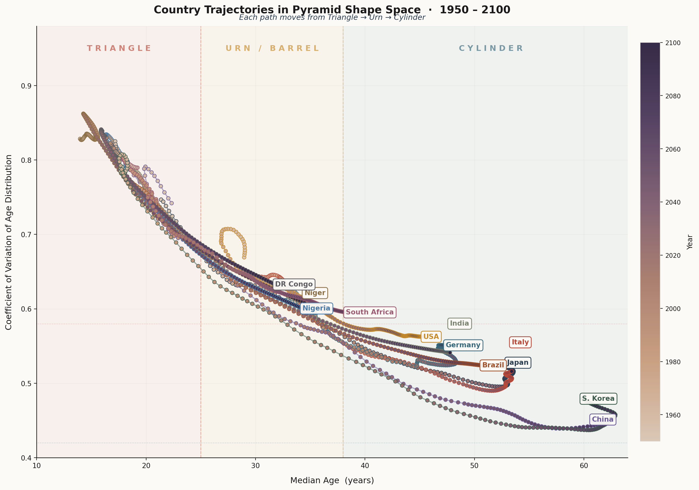
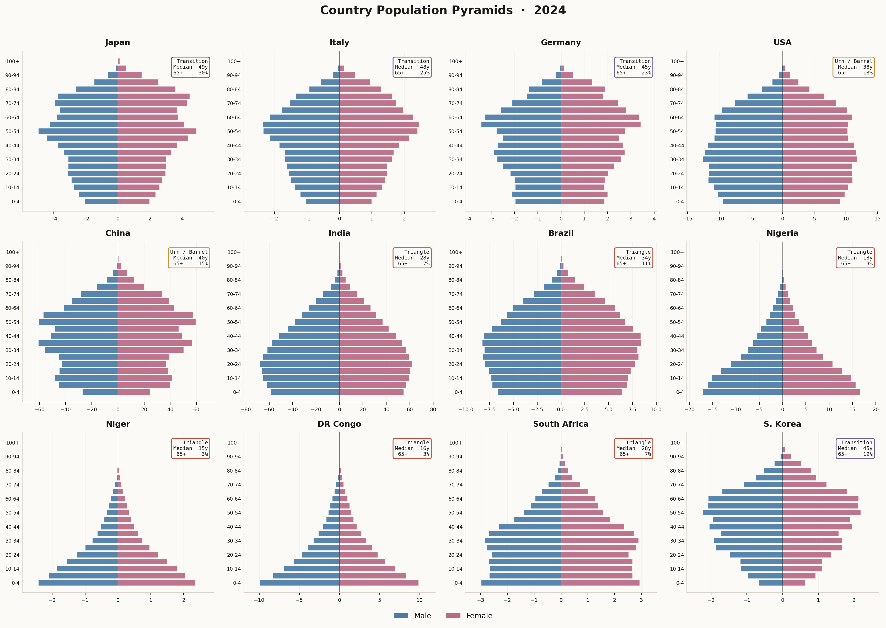
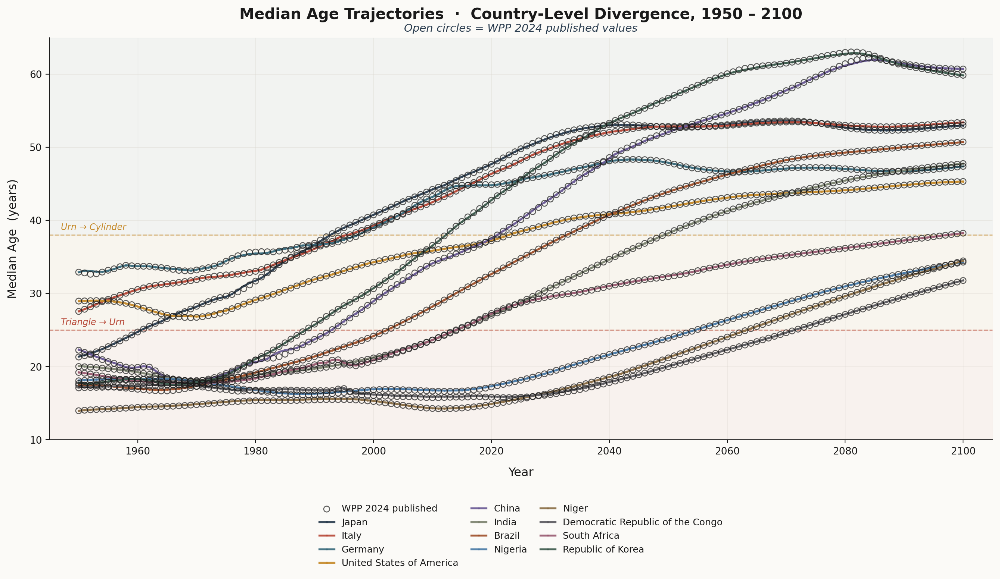
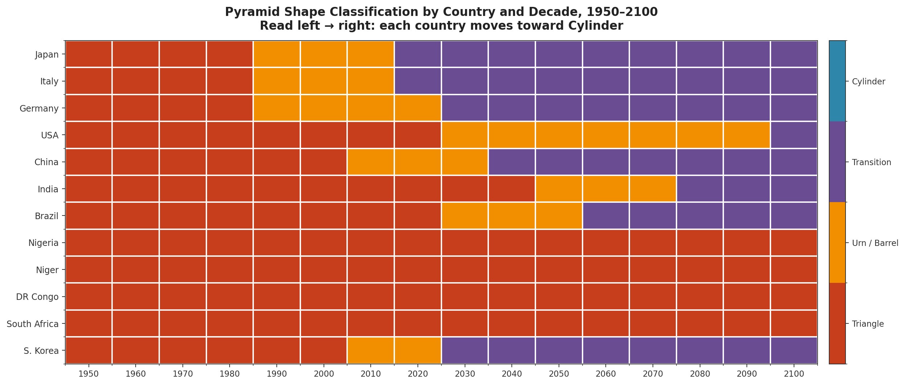

# global-population-pyramid-evolution

**Global population pyramid evolution (Triangle → Urn → Cylinder), 1950–2100 — UN WPP 2024 shape metrics, validation, animated pyramids, and publication figures.**

A reproducible Python workflow that measures the **shape** of national age structures from the **UN World Population Prospects 2024 (WPP 2024)**, validates the computed median age against WPP's published values, and produces animated pyramids, a comparative dashboard, and publication-grade static figures.

**Topics:** `un-wpp` · `population-pyramids` · `demography` · `python` · `matplotlib` · `animation` · `data-validation`

---


## Animations

### Comparative dashboard

6 countries, 1950–2100 in 10-year steps.


## Contents

- [Highlights](#highlights)
- [Repository structure](#repository-structure)
- [Data](#data)
- [Methods](#methods)
- [Validation](#validation)
- [Results — shape classification (2100)](#results--shape-classification-2100)
- [Figures](#figures)
- [Animations](#animations)
- [Outputs](#outputs)
- [Requirements](#requirements)
- [Running](#running)
- [Customisation](#customisation)
- [Citation](#citation)
- [License](#license)

---

## Highlights

- **12 countries** spanning the full ageing spectrum: Japan, Italy, Germany, USA, China, India, Brazil, Nigeria, Niger, DR Congo, South Africa, Republic of Korea.
- **WPP-aligned median age** — continuous within-band interpolation with a **−1.0 y** offset to match WPP's integer-age convention (age at last birthday).
- **Validation:** 1812/1812 country-year checks (100 %) within **±1 year** of WPP `MedianAgePop`; 60/60 anchor-year checks (1950, 2000, 2024, 2050, 2100) within ±1 year. Max |diff| = 0.66 y.
- **CV-first shape classifier** calibrated to WPP 2024 labels:
  - `Triangle` — CV > 0.58
  - `Cylinder` — CV < 0.42
  - `Transition` — median ≥ 45
  - `Urn / Barrel` — otherwise
- **Open data** from UN WPP CSV endpoints; downloaded once and cached locally under `wpp_cache/`.
- **LFS-tracked animations** (13 GIFs) render inline on GitHub.

---

## Repository structure

```
global-population-pyramid-evolution/
├── README.md
├── LICENSE
├── .gitignore
├── .gitattributes                   # Git LFS tracking for *.gif
├── population_pyramids.py           # main workflow
├── data/
│   ├── country_shape_metrics.csv    # per-country-year shape metrics
│   └── validation_anchor_years.csv  # anchor-year validation table
└── figures/
    ├── fig1_shape_trajectories.png
    ├── fig2_pyramids_2024.png
    ├── fig3_median_age_trajectories.png
    ├── fig4_shape_heatmap.png
    └── animations/
        ├── comparative_dashboard.gif
        ├── pyramid_Japan.gif
        ├── pyramid_Italy.gif
        ├── pyramid_Germany.gif
        ├── pyramid_United_States_of_America.gif
        ├── pyramid_China.gif
        ├── pyramid_India.gif
        ├── pyramid_Brazil.gif
        ├── pyramid_Nigeria.gif
        ├── pyramid_Niger.gif
        ├── pyramid_Democratic_Republic_of_the_Congo.gif
        ├── pyramid_South_Africa.gif
        └── pyramid_Republic_of_Korea.gif
```

---

## Data

**UN World Population Prospects 2024 — Standard edition, CSV files:**

| File | URL |
|---|---|
| Age structure (5-year bands, by sex) | `WPP2024_PopulationByAge5GroupSex_Medium.csv.gz` |
| Demographic indicators (median age) | `WPP2024_Demographic_Indicators_Medium.csv.gz` |

Base URL: `https://population.un.org/wpp/assets/Excel%20Files/1_Indicator%20(Standard)/CSV_FILES/`

Both files are downloaded once, then cached as `.csv.gz` under `wpp_cache/` (excluded from git).

---

## Methods

### 1. Median age (WPP-aligned)

Find the 5-year age band that crosses the cumulative 50 % share and interpolate:

```
median = band_start + 5 × (0.5 − cumulative_before) / share_of_band
```

Then subtract **1.0 year** to match WPP's integer-age reporting convention (age at last birthday). Without this offset, computed medians sit systematically ≈ +1.0 y above WPP's published values.

### 2. Coefficient of variation of the age distribution

Weighted moments using band midpoints, plus a within-band variance correction `+5²/12`:

```
mean = Σ share · midpoint
var  = Σ share · (midpoint − mean)² + 25/12
CV   = √var / mean
```

### 3. Skewness

Exact 3rd central moment assuming a uniform distribution within each 5-year band.

### 4. Shape classifier (CV-first)

| Class | Rule |
|---|---|
| **Triangle** | CV > 0.58 |
| **Cylinder** | CV < 0.42 |
| **Transition** | median age ≥ 45 (and CV between 0.42–0.58) |
| **Urn / Barrel** | otherwise (CV between 0.42–0.58, median < 45) |

Calibrated against WPP 2024's own labels.

### 5. Sanity checks

- `young + working + old = 1` (max error `2.22 × 10⁻¹⁶`)
- All populations positive
- CV range: **0.437 – 0.862**
- Median age range: **14.0 – 62.9 y**

---

## Validation

Compared against WPP's published `MedianAgePop` for all 12 countries × 151 years (1950–2100):

| Metric | Value |
|---|---|
| Country-year checks | **1812** |
| Within ±1 year | **1812 / 1812 (100.0 %)** |
| Within ±2 years | **1812 / 1812 (100.0 %)** |
| Mean difference | **+0.020 y** |
| Median difference | **+0.013 y** |
| Std difference | **0.067 y** |
| Max \|difference\| | **0.66 y** (China 1984) |
| Anchor-year validation (1950, 2000, 2024, 2050, 2100) | **60 / 60 (100 %)** within ±1 y |

Worst 10 deviations (all under 0.7 y):

| Location | Year | Computed | WPP | Δ |
|---|---|---|---|---|
| China | 1984 | 22.02 | 21.36 | +0.66 |
| China | 1985 | 22.25 | 21.70 | +0.54 |
| Germany | 1952 | 33.08 | 32.63 | +0.45 |
| China | 1983 | 21.61 | 21.16 | +0.45 |
| China | 2082 | 61.58 | 61.97 | −0.40 |
| China | 2083 | 61.76 | 62.15 | −0.40 |
| China | 2081 | 61.37 | 61.73 | −0.36 |
| Japan | 1978 | 31.01 | 30.66 | +0.35 |
| China | 2084 | 61.89 | 62.21 | −0.32 |
| China | 1981 | 20.78 | 21.09 | −0.31 |

---

## Results — shape classification (2100)

| Country | Median age | CV | Shape |
|---|---|---|---|
| DR Congo | 31.8 y | 0.63 | Triangle |
| Nigeria | 34.3 y | 0.60 | Triangle |
| Niger | 34.5 y | 0.61 | Triangle |
| South Africa | 38.3 y | 0.60 | Triangle |
| United States of America | 45.3 y | 0.56 | Transition |
| Germany | 47.4 y | 0.55 | Transition |
| India | 47.8 y | 0.54 | Transition |
| Brazil | 50.7 y | 0.52 | Transition |
| Japan | 53.0 y | 0.53 | Transition |
| Italy | 53.4 y | 0.52 | Transition |
| Republic of Korea | 59.8 y | 0.48 | Transition |
| China | 60.7 y | 0.45 | Transition |

Reading the trajectories left → right in shape space (Fig. 1): every country moves **Triangle → Urn → Cylinder** as median age rises and the age distribution narrows. Even by 2100, several countries are still in the "Transition" band under the strict CV-first classifier — an artefact of the CV thresholds (0.42 / 0.58) rather than of the underlying demography.

---

## Figures

### Fig. 1 — Country trajectories in shape space, 1950–2100

Each path starts in the Triangle zone and moves toward the Cylinder zone; points are coloured by year.



### Fig. 2 — Population pyramids, 2024

Small multiples of the 2024 pyramid for all 12 countries, annotated with the shape class, median age, and 65+ share.



### Fig. 3 — Median-age trajectories, 1950–2100

Computed trajectories (lines) with WPP-published values (open circles) overlaid for validation.



### Fig. 4 — Shape classification heatmap by country × decade



---

## Animations

### Comparative dashboard

6 countries, 1950–2100 in 10-year steps.


### Per-country pyramids (5-year steps)

| Country | Animation |
|---|---|
| Japan |  |
| Italy |  |
| Germany |  |
| United States of America |  |
| China |  |
| India |  |
| Brazil |  |
| Nigeria |  |
| Niger |  |
| DR Congo |  |
| South Africa |  |
| Republic of Korea |  |

GIFs are tracked with **Git LFS** (`.gitattributes` in the repo root), so they display inline on GitHub.

---

## Outputs

### Publication figures (`figures/`)

| File | Description |
|---|---|
| `fig1_shape_trajectories.png` | Country trajectories in shape space (median age × CV), 1950–2100 |
| `fig2_pyramids_2024.png` | Small-multiples of the 2024 pyramid for all 12 countries |
| `fig3_median_age_trajectories.png` | Median-age trajectories with WPP 2024 reference points overlaid |
| `fig4_shape_heatmap.png` | Shape classification by country × decade |

### Animations (`figures/animations/`)

| File | Description |
|---|---|
| `comparative_dashboard.gif` | 6-country animated grid, 1950–2100 (10-year steps) |
| `pyramid_<country>.gif` | Per-country animated pyramid (5-year steps), 12 files |

### Data tables (`data/`)

| File | Description |
|---|---|
| `country_shape_metrics.csv` | All shape metrics per country-year (12 × 151 = 1812 rows) |
| `validation_anchor_years.csv` | Anchor-year validation table (12 × 5 = 60 rows) |

`country_shape_metrics.csv` columns: `location`, `year`, `median_age`, `mean_age`, `std_age`, `cv_age`, `skew_age`, `young_share`, `working_share`, `old_share`, `old_young_ratio`, `dependency_ratio`, `total_pop_millions`, `shape`.

---

## Requirements

```bash
pip install pandas numpy matplotlib requests
```

Only `pandas`, `numpy`, `matplotlib`, and `requests` are needed (plus standard library: `gzip`, `io`, `pathlib`, `re`, `warnings`). Tested with Python 3.10+ and Matplotlib 3.7+.

To pull LFS animations after cloning:

```bash
git lfs install      # once, if not already installed
git lfs pull
```

---

## Running

```bash
git clone https://github.com/zafariabbas68/global-population-pyramid-evolution.git
cd global-population-pyramid-evolution
pip install pandas numpy matplotlib requests
python population_pyramids.py
```

On first run, `population_pyramids.py` will:

1. Download ≈ 150 MB of WPP 2024 CSV files and cache them under `wpp_cache/`.
2. Compute shape metrics for all 12 countries × 151 years.
3. Validate against WPP `MedianAgePop`.
4. Write all figures and animations to the current directory.

The script takes ~10–20 minutes on a laptop (most of the time is animation rendering).

---

## Customisation

All tuneable parameters are at the top of `population_pyramids.py`:

| Parameter | Effect |
|---|---|
| `country_selection` | The 12-country set — add or remove entries |
| `WPP_CONVENTION_OFFSET` | `-1.0` matches WPP's integer-age convention; change only if WPP changes its reporting |
| `classify_shape()` thresholds | CV cut-points (0.58 / 0.42) and median-age cut-point (45) |
| `animate_country_pyramid(step=5)` | Step size (years) for per-country animations |
| `animate_comparative_dashboard(step=10)` | Step size for the comparative dashboard |
| `target_year` in Fig. 2 | Choose any year in the dataset |

The `WPP_CONVENTION_OFFSET` is the *only* place the −1 y convention adjustment is applied, so validation remains clean if you change it.

---

## Citation

If you use this code or outputs, please cite:

> Zafari, G. A. (2025). *global-population-pyramid-evolution: Global population pyramid evolution, 1950–2100 — Triangle → Urn → Cylinder*. GitHub: https://github.com/zafariabbas68/global-population-pyramid-evolution

And the underlying data source:

> United Nations, Department of Economic and Social Affairs, Population Division (2024). *World Population Prospects 2024, Standard edition*.

---

## License

Code: MIT (see [LICENSE](LICENSE)).

Data: UN WPP 2024 — please follow the UN's terms of use for the source CSV files.
